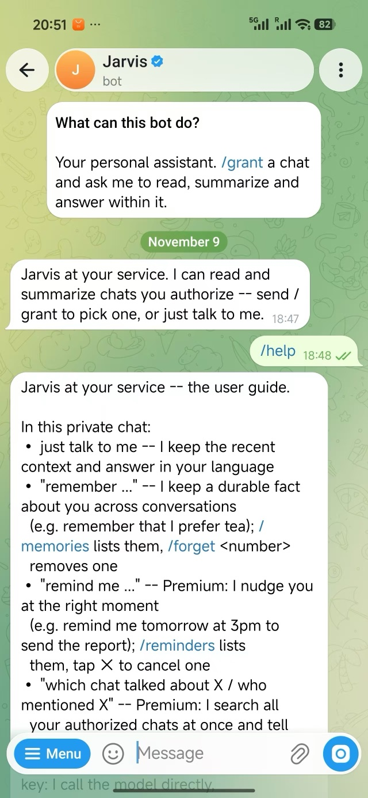
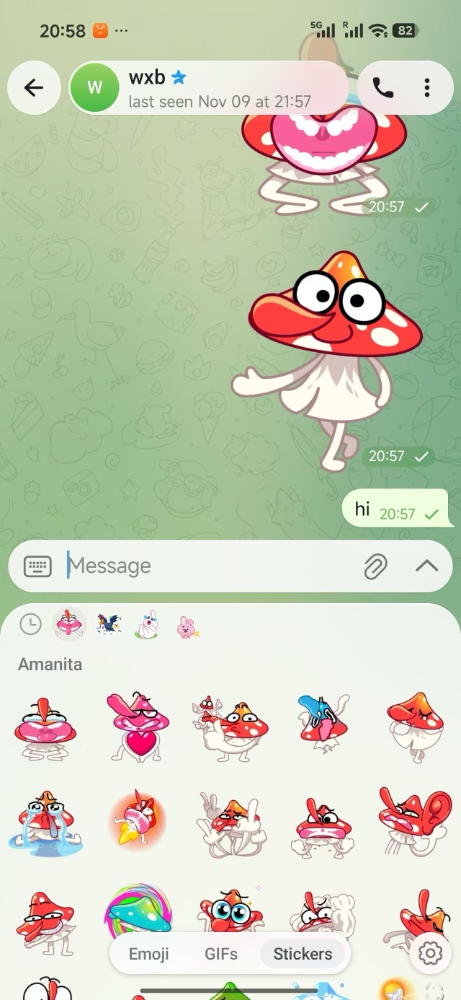
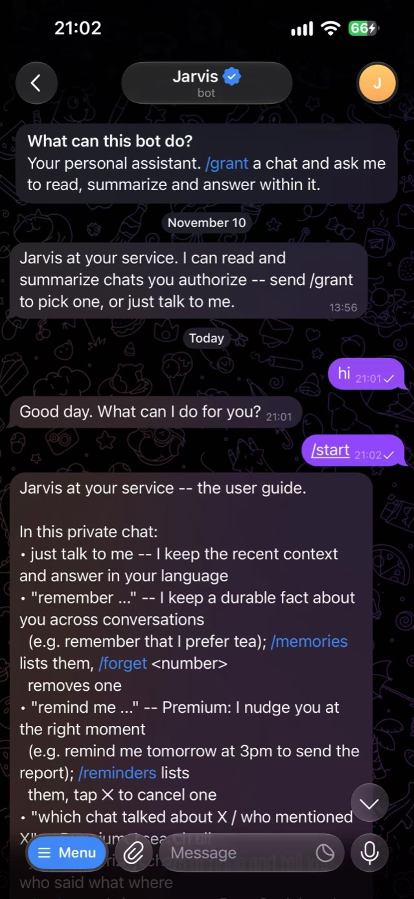

<p align="center"></p>
<h1 align="center">Talky for Android</h1>
<p align="center"><strong>Your people. Your conversations. Your personal AI.</strong></p>
<p align="center">
<a href="https://talkytalky.im/?utm_source=github&utm_medium=readme&utm_campaign=talky_android">Official website</a> ·
<a href="https://talkytalky.im/download.html?utm_source=github&utm_medium=readme&utm_campaign=talky_android">Downloads</a> ·
<a href="docs/BUILDING.md">Build from source</a> ·
<a href="https://github.com/mailes/talky-ios">iOS source</a> ·
<a href="https://github.com/mailes/talky-desktop">Desktop source</a> ·
  <a href="https://github.com/mailes/talky-web">Web source</a> ·
  <a href="README.zh-CN.md">简体中文</a>
</p>

Talky is a messaging app with private conversations, groups, calls, themes, and **Jarvis**, a personal AI assistant inside your chats. This repository contains the Android client source, derived from Telegram Android and OwpenGram, with Talky product and service integration.

**Current website release: 13.2.2 (O9), versionCode 73049.** Get the official APK from the [Talky download page](https://talkytalky.im/download.html?utm_source=github&utm_medium=readme&utm_campaign=talky_android). Keep the same signing identity when upgrading an existing installation.

<table><tr>
<td></td>
<td></td>
<td></td>
</tr></table>

## What you can explore

- **Messages and groups:** conversations, replies, reactions, media and files.
- **Jarvis:** questions, authorised summaries, memories and reminders, with availability depending on service configuration and subscription.
- **Voice and video:** calls alongside your conversations.
- **Personalisation:** chat themes, appearance controls, stickers and custom emoji.
- **Direct distribution:** a standalone APK and the Talky website update feed.

This is the Android **client**, not the backend or an AI model. Source availability does not grant access to production infrastructure, subscriptions or third-party services. See the [privacy policy](https://talkytalky.im/privacy.html) for service data processing.

## Build a development APK

Use **JDK 17**, Android SDK 36, build tools 36.0.0, NDK 27.2.12479018 and CMake 3.22.1. The Gradle wrapper pins Gradle 8.13.

```sh
git clone --recurse-submodules https://github.com/mailes/talky-android.git
cd talky-android
cp private-build.properties.example private-build.properties
# Fill in your own API ID/hash and any optional provider settings.
scripts/build-android.sh debug
```

The debug build uses Android's standard debug signing key and a `.debug` application ID suffix. It does not need the official Talky signing key and will not replace the installed official APK. Signed standalone builds require **your own private signing configuration**. See [docs/BUILDING.md](docs/BUILDING.md).

Public examples contain no production API credentials or signing passwords. Google Maps, Google identity and Huawei features require your own provider configuration if you enable them. The standalone distribution does not require the inherited Firebase project files, which are excluded.

## Source and release relationship

The first public snapshot is based on the O9 working-tree source. It additionally moves provider/API credentials and signing settings into ignored local configuration, separates debug signing from release signing, and replaces private documentation with public guides. It is **not a byte-for-byte reproducible APK claim**.

The current source connects to Talky's service. If you run a different backend, review service selection and update-feed configuration. Rebranded forks should use their own application ID, signing key, service credentials and distribution endpoint.

## Contribute

Focused bug reports, documentation fixes and pull requests are welcome. Include Android version, device, reproduction steps and redacted logs. Never post private conversations, credentials or verification codes. See [CONTRIBUTING.md](CONTRIBUTING.md) and [SECURITY.md](SECURITY.md).

## License and acknowledgements

This derivative retains the Telegram Android **GNU GPL version 2 or later** licensing basis. See [LICENSE](LICENSE), [NOTICE.md](NOTICE.md), and individual dependency licenses. Original copyright notices remain in the source. Talky is independent of Telegram and is not an official Telegram application.

Thanks to [Telegram Android](https://github.com/DrKLO/Telegram) and the maintainers of the bundled libraries and pinned submodules.

Learn more at **[talkytalky.im](https://talkytalky.im/?utm_source=github&utm_medium=readme&utm_campaign=talky_android)**.
